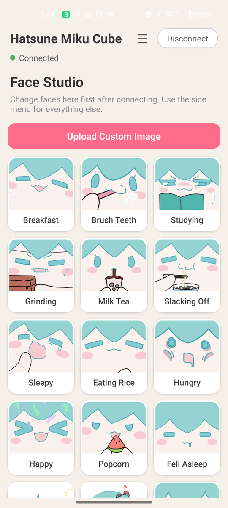
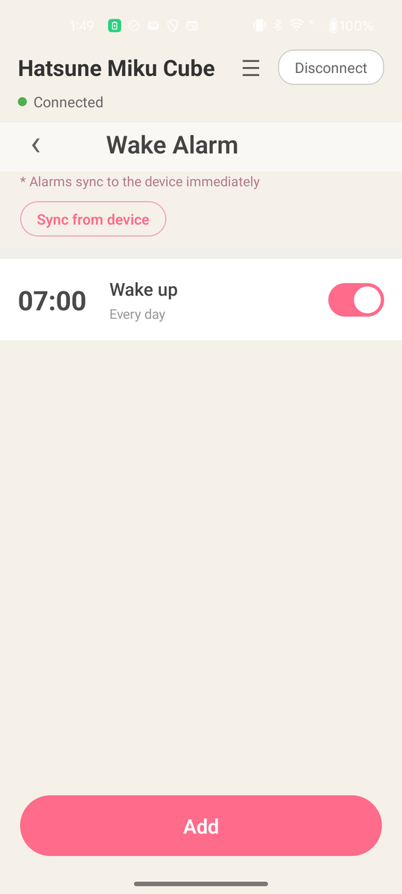
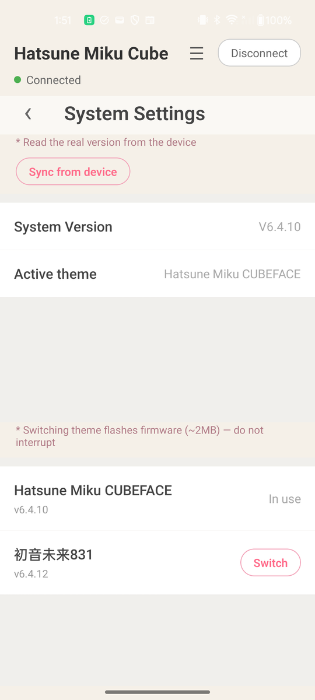
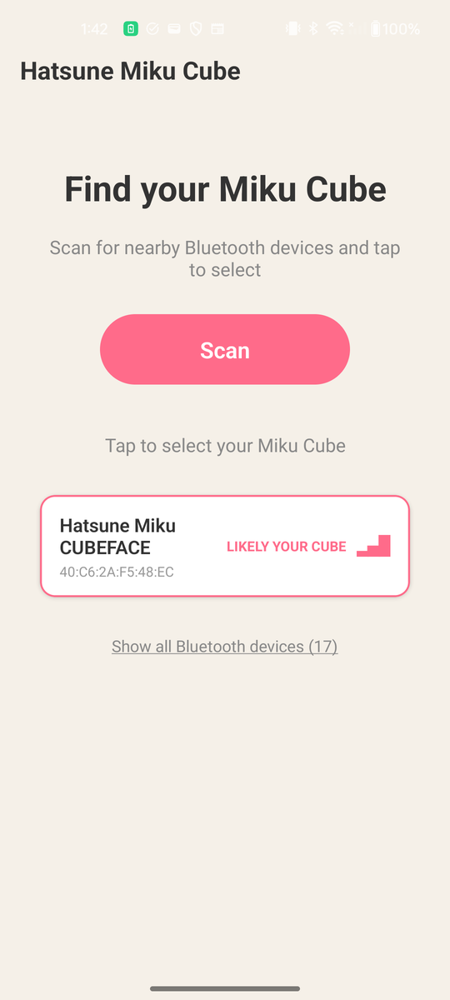
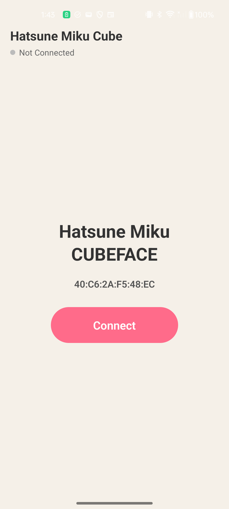
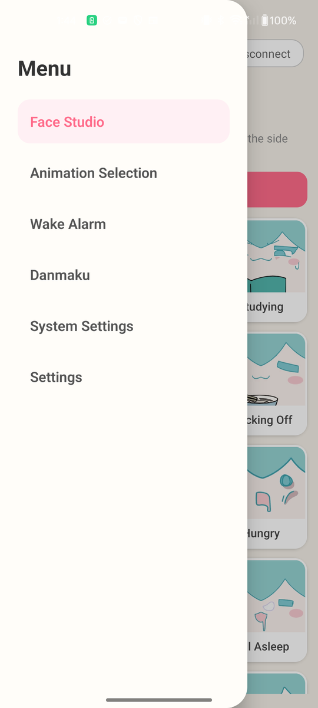
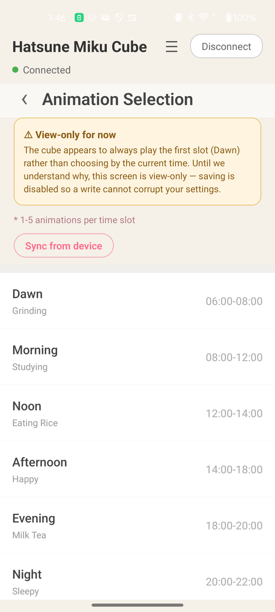
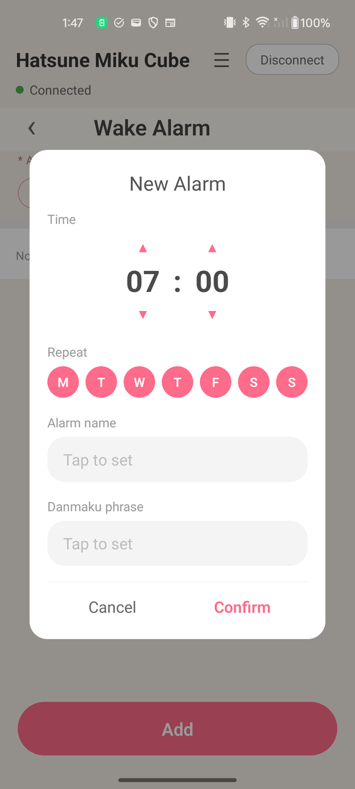
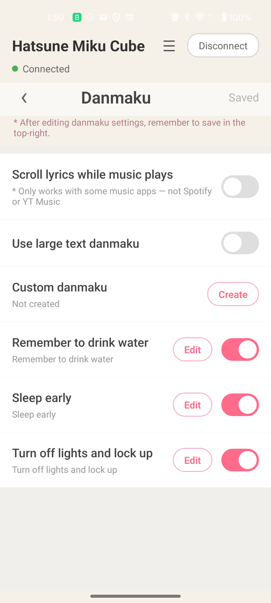

# MikuCube

An Android app for the **Hatsune Miku CUBEFACE** — change faces, upload your own
image, set alarms, configure danmaku, and switch firmware themes.

**No Bilibili app. No account. No login.** It talks to your cube directly over
Bluetooth.

### [⬇ Download the latest APK](../../releases/latest)

  
  
  

---

## Installing

The app isn't on Google Play, so you install the APK yourself.

1. Download the `.apk` from [**Releases**](../../releases/latest).
2. Open it. Android will say the source isn't trusted — tap **Settings** on that
   prompt and allow your browser (or Files app) to install unknown apps.
3. Install and open.

**"Play Protect doesn't recognise this app"** — expected for anything installed
outside the Play Store. Tap **More details → Install anyway**.

## Getting updates

There's no automatic updater outside the Play Store. Easiest option:

1. Install [**Obtainium**](https://github.com/ImranR98/Obtainium)
2. Add this repository's URL
3. It watches for new releases and updates you

Or just download a newer APK and install over the old one — your paired cube and
settings are kept.

---

## Setting up your cube

1. Turn the cube on and keep it near your phone.
2. **Open the back of the cube.** It only advertises over Bluetooth while the
   back is open — if it's shut, scanning finds nothing. This is by far the most
   common reason a scan comes up empty, so the scan screen reminds you too.
3. Open the app and tap **Scan**. Likely cubes are marked **LIKELY YOUR CUBE** —
   tap yours. (If it isn't listed, tap *Show all Bluetooth devices*.)
4. Confirm the Android pairing prompt. Picking your cube also adds it to your
   phone's own Bluetooth devices, so the earbuds work as an audio device — no
   need to pair it in system settings first. Everything in the app works without
   this, so if it doesn't take, the connect screen offers **Add to Bluetooth**.
5. Tap **Connect**.

  
  

Everything happens on-device — no internet, no account. The app remembers your
cube, so next time it connects straight away. To pair a different one, use
**Settings → Forget device** (that leaves the cube in your phone's Bluetooth
list; remove it there if you want it gone).

Saved connections can reconnect with the back closed. Initial setup still
requires opening the back.

### Setting the cube's clock

Connect the **earbuds** in Android's Bluetooth settings to synchronize the cube
with the phone. In the app, **System Settings → Cube clock → Open Bluetooth
settings** opens the right page. If the clock is wrong, check your phone's date,
time and timezone, then disconnect and reconnect the earbuds. Connecting only
the app does not set the displayed clock.

### Why does it ask for Location permission?

Android requires it for *any* app that scans for Bluetooth devices. The app
doesn't use, collect, or store your location.

---

## What you can do

| | |
|---|---|
| **Face Studio** | Preview a face and choose 1–1000 plays, or 0 for unlimited; upload and crop your own image |
| **Animation Selection** | Pick 1–5 animations for each time of day; repair missing schedule timing while keeping your selections |
| **Wake Alarm** | Alarms with repeat days and a scrolling message. **Use next alarm from Clock** fills in the time from your phone's own next alarm |
| **Danmaku** | Custom scrolling messages and reminders |
| **System Settings** | See your real firmware version, switch themes |

Face images are built into the app, so browsing works offline. Internet is only
needed to **switch themes**, which downloads a firmware image.

**Alarms and danmaku save as you edit.** In Face Studio, choose a count and tap
**Confirm** to apply it. For scheduled animations, choose a slot, select its
animations and tap **Save**.

Opening Alarms, Animation Selection or System Settings reads that screen from
the cube. A line at the top tells you whether you're looking at the cube's
settings or your saved copy, with **Refresh** if you've changed something in
the Bilibili app since.

  
  
  
  

---

## Known quirks

Current limitations and device behaviours:

- **Alarms.** The cube reads alarm times as China time, so alarms would normally
  fire hours late. The app corrects for this automatically, so alarms ring when
  you set them. Side effect: if you look at those alarms in the Bilibili app,
  the times will look shifted. That's expected.
- **Older animation schedules may need repair.** If the app detects missing
  timing, choose **Restore default times**. This keeps animation selections and
  resets custom time ranges. Healthy schedules can be edited normally. The
  selected slot was verified to change with local time after waking the cube;
  it did not visibly switch while idle during the test.
- **"Scroll lyrics while music plays"** only works with certain music apps.
  Spotify and YouTube Music don't drive it.

---

## 🙏 Can you help? Share your cube's data

Thank you to everyone who shared device dumps. Comparing those files revealed
the missing animation timing fields, and v1.0.2 restores scheduling and editing.

If your cube still behaves differently, a dump can help investigate:

1. Connect your cube.
2. Open **Settings → Copy device data**.
3. Review the text, then paste it into a [new issue](../../issues/new) with your
   firmware version, what you expected, and what happened.

The export is read-only. It includes animation schedules, alarm names and
messages, danmaku phrases, themes, the current face, the face catalogue and your
timezone offset. Remove any names or messages you do not want to share publicly.

---

## Switching themes

A "theme" on this device *is* a firmware image, downloaded and flashed over
Bluetooth. It takes a couple of minutes, and the cube restarts afterwards —
reconnect once it's back.

**Keep the cube charged and don't interrupt it.** The cube keeps a backup copy of
its firmware, so a failed flash isn't fatal and can be retried, but it's not
worth finding out the hard way.

---

## Troubleshooting

**Cube doesn't appear when scanning**
Try opening the back of the cube — it only advertises while the back is open,
and this is by far the most common reason a scan comes up empty. Also check it's
powered on and nearby, that Bluetooth and Location are enabled, and try *Show
all Bluetooth devices* in case it wasn't detected automatically.

**The cube isn't in my phone's Bluetooth list / the earbuds don't play audio**
Picking your cube in the app pairs it with the phone as well, but Android can
refuse or the prompt can get dismissed. Open the connect screen and tap **Add to
Bluetooth**, or **Open Bluetooth settings** to do it by hand.

**Connects, then nothing happens**
Force-close the app and reopen it. If the cube was recently restarted, give it a
few seconds before reconnecting.

**Stopped responding after a theme switch**
The cube reboots after flashing. Wait for it to come back, then reconnect.

**Something else**
Open an [issue](../../issues) and include what you did, what happened, and your
firmware version from **System Settings**.

---

## About

Independent, unofficial software. Not affiliated with, endorsed by, or supported
by bilibili, Crypton Future Media, or the device manufacturer. "Hatsune Miku"
and related characters are trademarks of their respective owners.

**Free, but not open source.** This repository holds the releases, not the code.
The app bundles the cube's own face animations so the picker works offline, and
part of how it talks to the cube came from taking the official app apart —
neither is mine to hand out. Bug reports and device-data dumps are very welcome
in [issues](../../issues) all the same.

Provided as-is, with no warranty. Use at your own risk — especially firmware
flashing.
